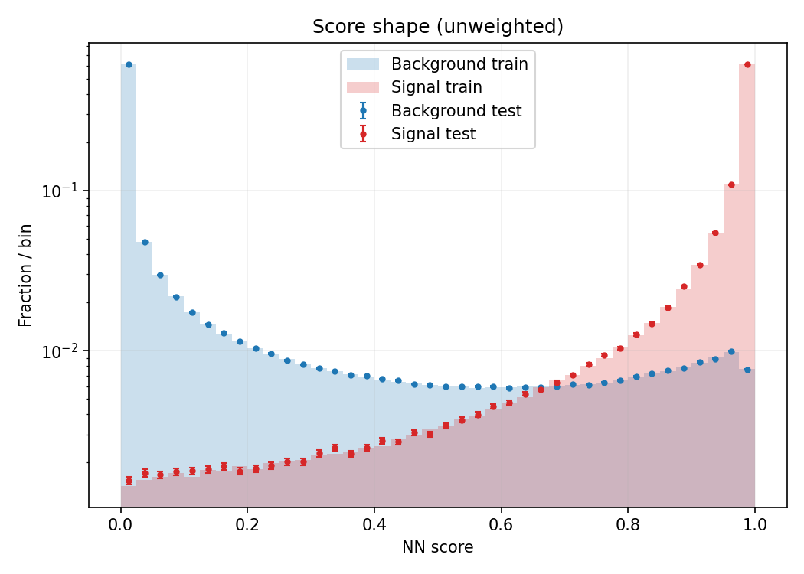
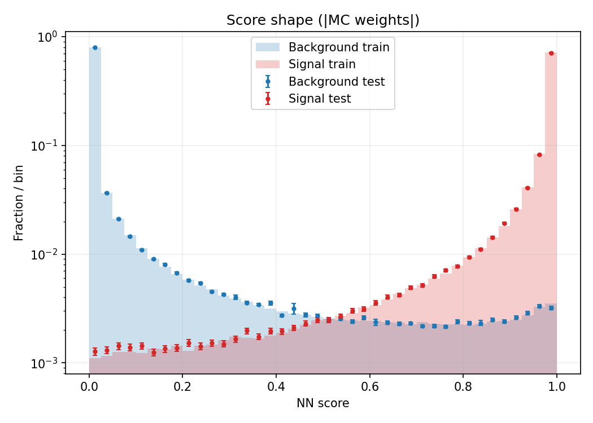
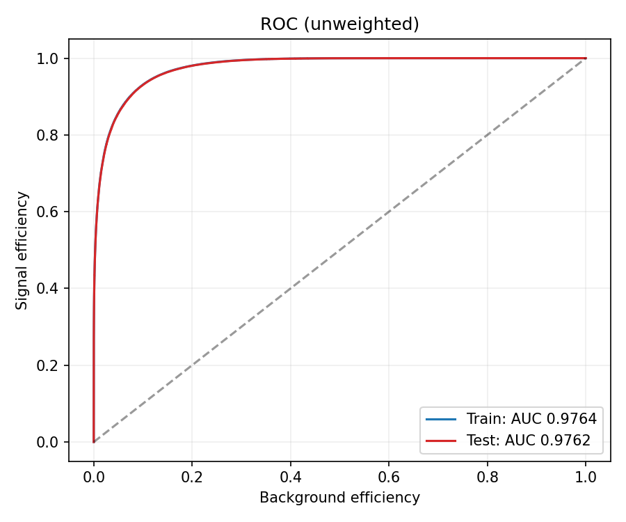
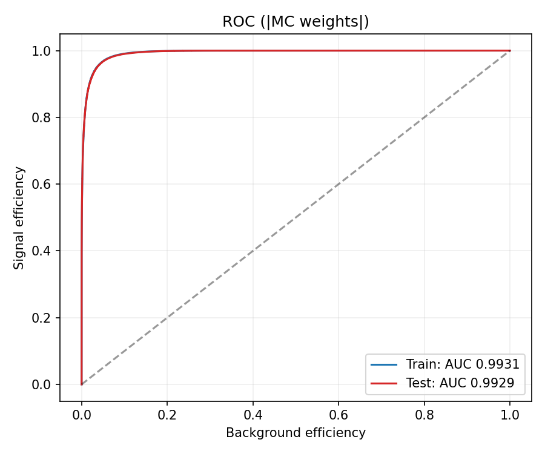
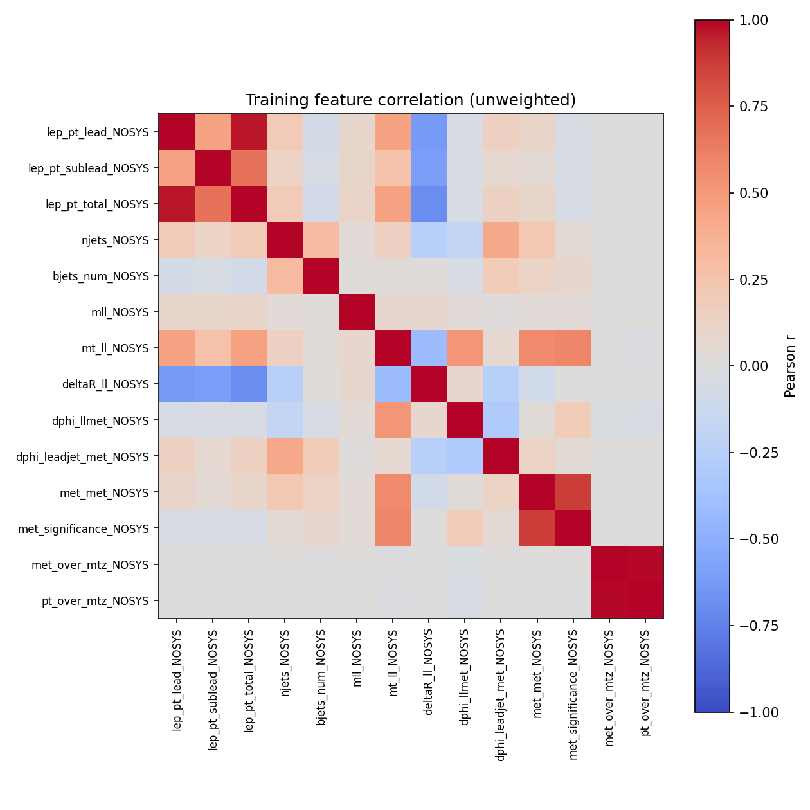
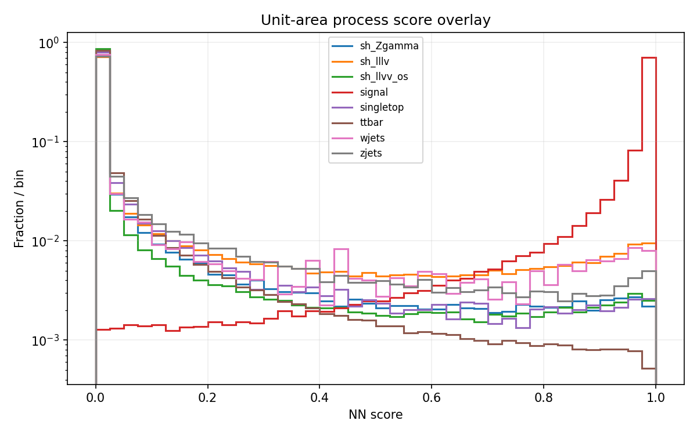
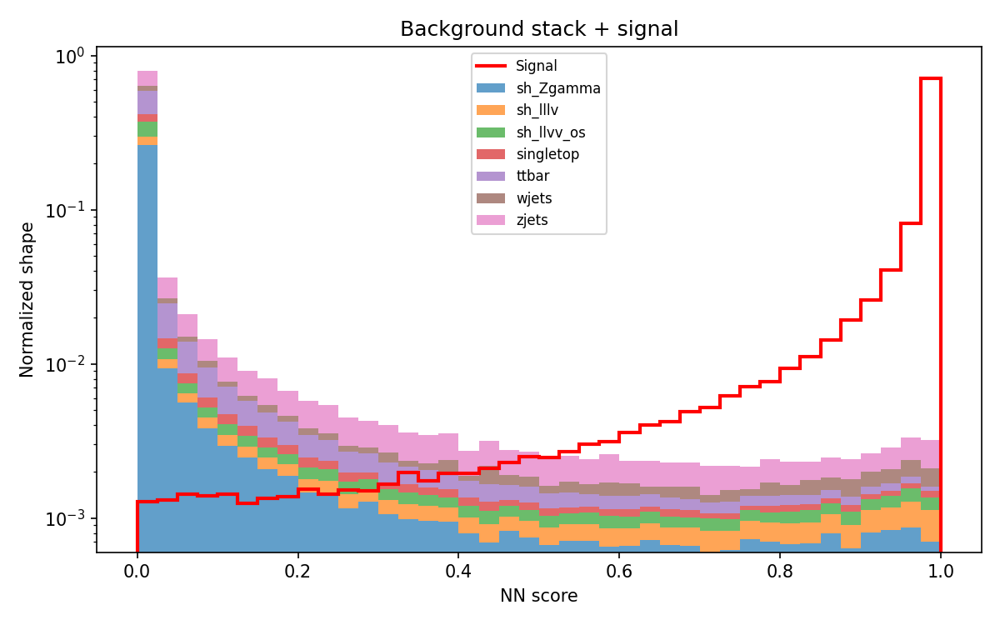

# ML Training Performance

This section presents the training diagnostics and performance evaluation of the machine learning classifier. The plots provide an overview of the classifier's discrimination performance, input feature correlations, and score distributions across different physics processes.

All plots are available in the [`plots/`](plots/) directory.

---

## 1. Classifier Score Distributions

The classifier output distributions for signal and background are compared with and without event weights.

<table>
  <tr>
    <th align="center">Unweighted</th>
    <th align="center">Weighted</th>
  </tr>
  <tr>
    <td align="center">
      
    </td>
    <td align="center">
      
    </td>
  </tr>
</table>

## 2. Receiver Operating Characteristic (ROC)

The ROC curves evaluate the classifier's ability to distinguish signal from background across different classification thresholds. Both weighted and unweighted evaluations are presented.

<table>
  <tr>
    <th align="center">Unweighted ROC</th>
    <th align="center">Weighted ROC</th>
  </tr>
  <tr>
    <td align="center">
      
    </td>
    <td align="center">
      
    </td>
  </tr>
</table>

## 3. Feature Correlation

The correlation matrix shows the pairwise correlations between input features, providing insight into their relationships and potential redundancy.

  

## 4. Process Overlay

The classifier score distributions for individual physics processes are overlaid to compare their responses and separation in the classifier output.

  

## 5. Normalized Process Stack

The normalized stacked distributions illustrate the relative contributions of different physics processes across the classifier score range.

  

---